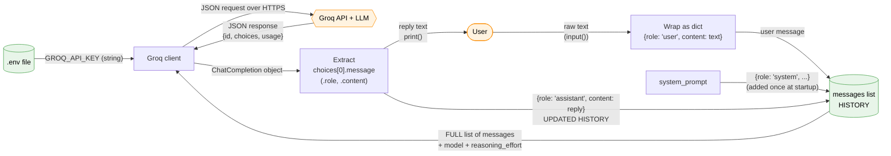
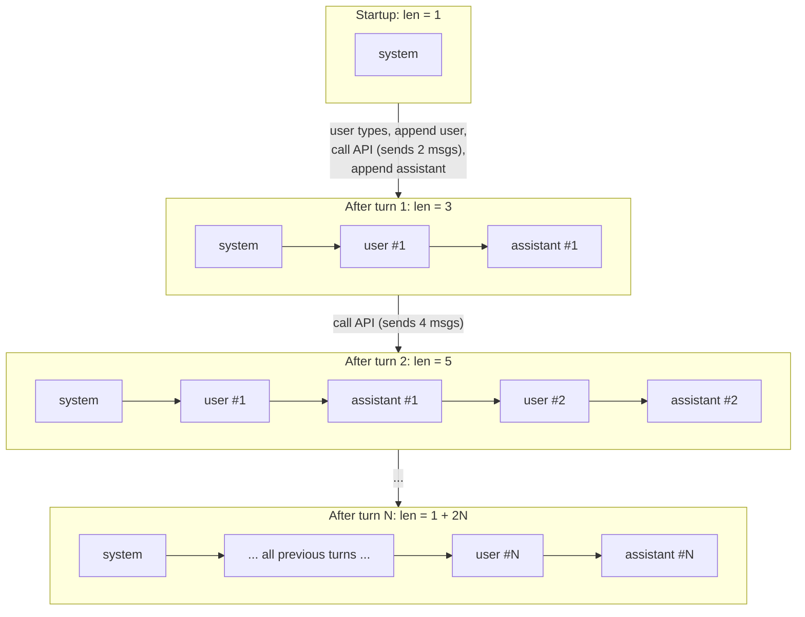

# Data Flow Diagram

## 1. How data moves through the application

`messages` is read on every API call and written twice per turn: once with the user's message before the call, and once with the assistant's reply after it.

## 2. How the history grows turn by turn

**Notes on the updated history**
- Each API call sends the whole list. Turn N sends `2N` messages: the system message, all earlier pairs, and the new user message.
- The history lives only in RAM. Pressing Ctrl + C wipes it, and nothing is saved to disk.
- The history grows without limit. In a long chat it will eventually exceed the model's context window and cost more tokens on every turn, so trimming or summarizing it is a natural next step.
