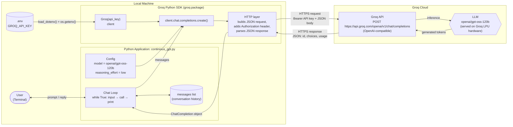

# Architecture: Python Application → Groq SDK → Groq API → LLM

| Layer | Responsibility |
|---|---|
| **Python Application** | Reads user input, keeps the `messages` history, prints replies |
| **Groq SDK** | Wraps the REST API: auth, request building, response parsing into Python objects |
| **Groq API** | Authenticates the key, routes the request to the model, returns JSON |
| **LLM** | Generates the assistant reply using the *entire* message history as context |
