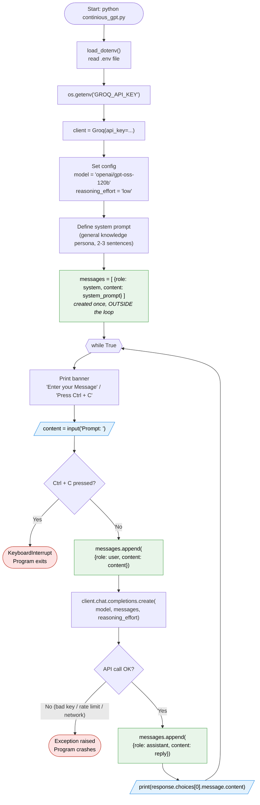

# Flowchart: Application Execution Flow

How `continious_gpt.py` runs from start to exit.

**Legend:** green = writes to `messages` (the conversation history), blue = terminal input/output, red = the program ends.
