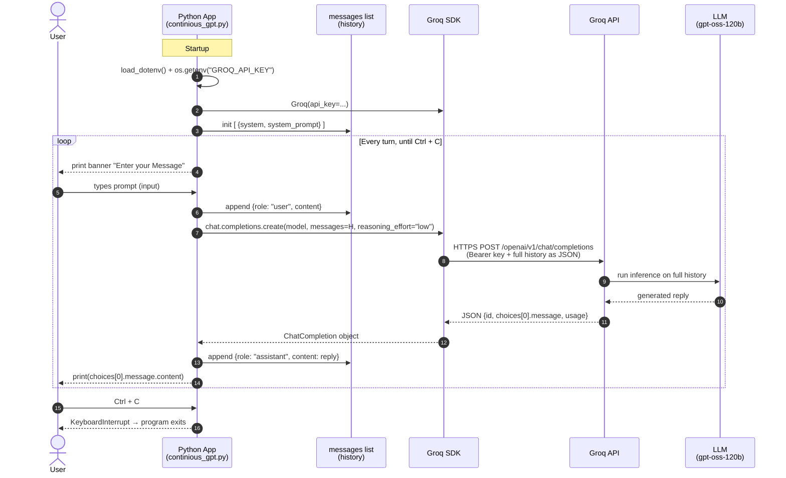

# Sequence Diagram: User → Python → Groq → Python → User

**Key point:** in step 5, the *whole* history goes to Groq every turn, not just the newest prompt. That's how the model "remembers" earlier turns. The API itself keeps no state between calls.
